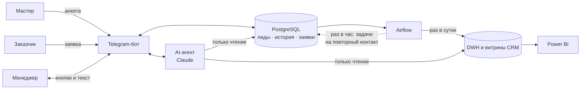

# Handyman CRM

CRM и аналитика для сервиса мастеров на час в Ереване. **Основные клиенты — мастера**: сервис
находит их, доводит до подключения и не теряет ни одного контакта. Заявки заказчиков — это
ценность, ради которой мастера подключаются.

Внутри: Telegram-бот на трёх языках, PostgreSQL, Airflow, витрины для Power BI и AI-агент на
Claude, с которым менеджер общается прямо в боте.



**Кто за что отвечает:** бот ведёт живое общение, PostgreSQL хранит контакты, статусы, историю
и задачи. Airflow работает в фоне: строит аналитику и находит забытых лидов, но сам никому не
пишет.

---

## Возможности

### Мастер (основной клиент)
- `/start` → «🧰 Я мастер» → короткое знакомство с сервисом → «Подключиться», «Хочу
  подробности» или «Не сейчас».
- Анкета на русском, английском или армянском: специализации, районы, телефон, согласие на
  напоминания.
- После одобрения менеджером мастер получает заявки своего профиля: `/new` — свободные,
  `/my` — в работе. Первый, кто нажал «Взять», получает контакты заказчика.
- `/stop` отключает напоминания и новости. Уведомления о своих заявках продолжают приходить.

### Менеджер
- `/leads` — воронка и конверсия, `/tasks` — кому написать сегодня, `/lead 12` — карточка
  мастера.
- Каждое утро в 10:00 приходят задачи карточками с кнопками: связался, переговоры,
  перенести, отказ с причиной, оплатил, подключить.
- Любой текст без команды уходит AI-агенту.

### Заказчик
- `/start` → «🏠 Мне нужен мастер»: категория, описание и фото, район, адрес, способ связи.
- `/orders` — свои заявки; отменить можно, пока мастер не взял заявку.

---

## CRM

**Воронка:** `new` → `contacted` → `negotiation` → `registration` → `connected`, или
`refused` с причиной. Состояние лида хранится в `leads`, полная история — в `lead_events`.

**Повторные контакты.** У каждого лида есть `last_contact_at`, `next_contact_at` и
`follow_up_reason`:

| Кто | Что делает |
|---|---|
| Бот | Напоминает тем, кто бросил анкету: через сутки и через 3 дня. Максимум два раза, после `/stop` — ни разу. Потом задача уходит менеджеру |
| Менеджер | Получает задачи в 10:00 и через `/tasks` |
| Airflow, `crm_follow_ups`, раз в час | Ставит задачу, если лид без контакта: добавлен вручную — сутки, в переговорах — 14 дней, подключён и не берёт заявки — 14 дней |

**Отказы и конверсия.** Причина отказа выбирается из справочника: условия, цена, мало заказов
в районе, сложная регистрация, непонятная ценность, нет нужной функции, другое. После каждой
загрузки пересчитываются витрины:

| Витрина | Что показывает |
|---|---|
| `dwh_mart_lead_funnel` | Конверсия «контакт → подключение» и «переговоры → оплата», доля отказов, среднее число дней до подключения. Разрез: месяц × источник × версия сценария |
| `dwh_mart_refusals` | Отказы по причинам и районам |
| `dwh_mart_district_balance` | По районам: мастера, лиды и заявки за 30 дней. Помогает понять, проблема в спросе или в продажах |
| `dwh_mart_lead_status_daily` | Снимок воронки на каждый день |

`SCRIPT_VERSION` в `.env` помечает новых лидов версией сценария общения. Так конверсию можно
сравнивать между сопоставимыми группами.

---

## AI-агент

Работает на Claude (`AGENT_MODEL`, по умолчанию `claude-opus-5-5`):

| Инструмент | Что делает |
|---|---|
| `run_sql` | Выполняет один `SELECT` к базе бота или DWH под ролью `agent_ro` (только чтение, таймаут 10 с) |
| `add_lead` / `update_lead` | Добавляет мастера, записывает контакт, статус, отказ, следующий шаг, оплату, заметку |
| `prepare_broadcast` | Готовит рассылку мастерам или заказчикам с учётом их согласия |

Примеры запросов:
- «кому из мастеров пора написать сегодня?»
- «поговорил с Ашотом, думает до пятницы»
- «почему отказываются в Шенгавите?»
- «напомни мастерам, которые не закончили регистрацию»

Чего агент не может: изменять данные через SQL, подключать мастеров (это делает только
менеджер кнопкой) и отправлять сообщения сам — рассылка уходит после кнопки «✅ Отправить».

Агента можно запустить и в терминале: `python -m app.agent`.

---

## Запуск

Нужен Docker Desktop.

```bash
cp .env.example .env   # BOT_TOKEN, MANAGER_CHAT_IDS, ANTHROPIC_API_KEY
docker compose up -d --build
```

Напишите боту `/start`, затем `docker compose restart bot` — после этого у менеджера появится
меню команд. Свой chat id можно узнать командой `/myid`. Без `ANTHROPIC_API_KEY` бот работает,
но агент выключен.

| Сервис | Адрес |
|---|---|
| Airflow | http://localhost:8080 (admin / admin): `handyman_etl` — раз в сутки, `crm_follow_ups` — раз в час |
| PostgreSQL | `localhost:5436`, `app` / `app`: база бота `handyman`, хранилище `dwh` |
| Power BI | `localhost:5436`, база `dwh`, витрины `dwh_mart_*` |
| Логи бота | `docker compose logs -f bot` |

**Обновление схемы на работающей базе.** Скрипты в `sql/init` идемпотентные, данные
сохраняются:

```bash
docker compose exec postgres-data psql -U app -d handyman -f /docker-entrypoint-initdb.d/10_operational.sql
docker compose exec postgres-data psql -U app -d handyman -f /docker-entrypoint-initdb.d/20_layers.sql
docker compose up -d --build bot
```

---

## ETL

`handyman_etl` работает в несколько шагов:
1. Инкрементальная загрузка 9 таблиц бота в слой MRR по High Water Mark. Окно читается с
   запасом в 10 минут, запись идёт через upsert пачками.
2. MRR → STG → DWH: таблица очищается и заливается заново в одной транзакции.
3. `build_crm_marts` пересчитывает витрины.
4. Каждая задача пишет итог в `etl_logs`.

Телефоны, адреса и тексты сообщений в аналитику не попадают.

---

## Структура

```
app/
  leads.py         CRM: лиды, история, задачи, автонапоминания
  db.py            заявки, заказчики, рассылки
  notify.py        отправка сообщений с журналом
  texts.py         тексты RU / EN / HY
  bot/             onboarding — воронка мастера, crm — карточки и задачи,
                   followups — напоминания и утренние задачи, customer, master, manager
  agent/           agent — цикл tool use, tools — инструменты, prompt — системный промпт
dags/              handyman_etl.py, crm_follow_ups.py, etl_common.py
sql/init/          схемы всех баз
Отчет.pbix         дашборд Power BI
```

## Дальше

- Страница CRM в `Отчет.pbix` по витринам `dwh_mart_*`.
- Экраны работы с заявками для мастера на армянском и английском.
- Хранить состояние диалогов бота в Redis.
- Проверки качества данных, мониторинг, CI/CD.
